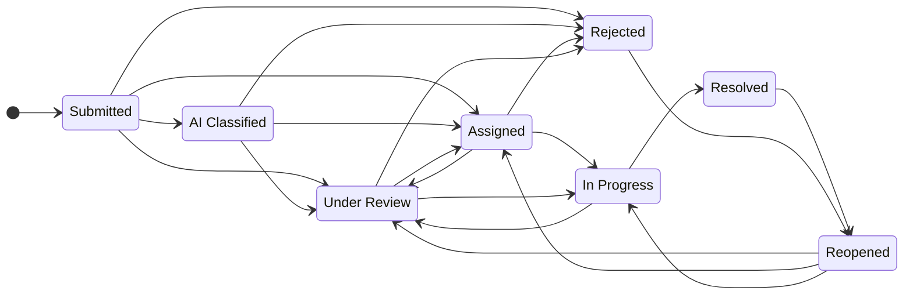
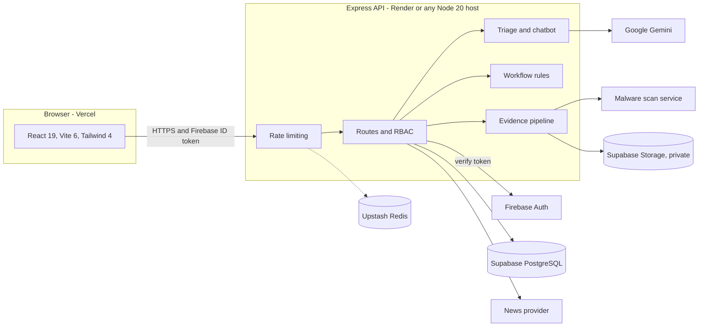

  <title id="t">Tamil-nadu-grievance-management - Report. Route. Resolve.</title>
  <desc id="d">Animated wordmark for the Tamil Nadu grievance management repository, an AI-assisted public grievance redressal platform for Tamil Nadu.</desc>
  <style>
    .l{font:700 56px 'JetBrains Mono','SFMono-Regular',ui-monospace,Menlo,Consolas,'DejaVu Sans Mono',monospace;fill:#FAFAFA;text-anchor:middle;animation:drop .75s cubic-bezier(.2,.8,.2,1) both}
    .l.ai{fill:#E7A817}
    .t{font:500 26px 'JetBrains Mono','SFMono-Regular',ui-monospace,Menlo,Consolas,'DejaVu Sans Mono',monospace;fill:#D4D4D8;text-anchor:middle;animation:pop .01s steps(1) both}
    .t.dot{fill:#E7A817}
    .tag{font:500 13px 'JetBrains Mono','SFMono-Regular',ui-monospace,Menlo,Consolas,'DejaVu Sans Mono',monospace;letter-spacing:3px;fill:#A1A1AA;animation:fade .8s ease .1s both}
    .foot{font:500 13px 'JetBrains Mono','SFMono-Regular',ui-monospace,Menlo,Consolas,'DejaVu Sans Mono',monospace;letter-spacing:2px;fill:#71717A;text-anchor:middle;animation:fade .9s ease 2.79s both}
    .rule{stroke:#E7A817;stroke-width:3;stroke-linecap:round;stroke-dasharray:1054;animation:draw .9s cubic-bezier(.6,0,.2,1) 1.2s both}
    .mark{animation:fade 1s ease .5s both}
    .cur{fill:#E7A817;opacity:0;animation:blink 1.1s steps(1) 2.73s infinite}
    @keyframes drop{0%{opacity:0;transform:translateY(-38px)}60%{opacity:1;transform:translateY(7px)}100%{opacity:1;transform:translateY(0)}}
    @keyframes pop{from{opacity:0}to{opacity:1}}
    @keyframes fade{from{opacity:0}to{opacity:1}}
    @keyframes draw{from{stroke-dashoffset:1054}to{stroke-dashoffset:0}}
    @keyframes blink{0%,49%{opacity:1}50%,100%{opacity:0}}
    @media (prefers-reduced-motion:reduce){*{animation:none!important}.cur{opacity:0}}
  </style>
  <defs><pattern id="dots" width="24" height="24" patternUnits="userSpaceOnUse"><circle cx="1.5" cy="1.5" r="1" fill="#fff" fill-opacity=".055"/></pattern></defs>
  <rect x=".5" y=".5" width="1199" height="379" rx="18" fill="#09090B" stroke="#fff" stroke-opacity=".10"/>
  <rect x=".5" y=".5" width="1199" height="379" rx="18" fill="url(#dots)"/>
  <line x1="28" y1="1" x2="1172" y2="1" stroke="#fff" stroke-opacity=".14"/>
  <text class="tag" x="60" y="62">PUBLIC GRIEVANCE REDRESSAL  /  TAMIL NADU</text>
  <g>
    <text class="l ai" x="90.0" y="200" style="animation-delay:0.25s">T</text>
    <text class="l ai" x="124.0" y="200" style="animation-delay:0.31s">a</text>
    <text class="l ai" x="158.0" y="200" style="animation-delay:0.37s">m</text>
    <text class="l ai" x="192.0" y="200" style="animation-delay:0.43s">i</text>
    <text class="l ai" x="226.0" y="200" style="animation-delay:0.49s">l</text>
    <text class="l ai" x="260.0" y="200" style="animation-delay:0.55s">-</text>
    <text class="l ai" x="294.0" y="200" style="animation-delay:0.61s">n</text>
    <text class="l ai" x="328.0" y="200" style="animation-delay:0.67s">a</text>
    <text class="l ai" x="362.0" y="200" style="animation-delay:0.73s">d</text>
    <text class="l ai" x="396.0" y="200" style="animation-delay:0.79s">u</text>
    <text class="l ai" x="430.0" y="200" style="animation-delay:0.85s">-</text>
    <text class="l" x="464.0" y="200" style="animation-delay:0.91s">g</text>
    <text class="l" x="498.0" y="200" style="animation-delay:0.97s">r</text>
    <text class="l" x="532.0" y="200" style="animation-delay:1.03s">i</text>
    <text class="l" x="566.0" y="200" style="animation-delay:1.09s">e</text>
    <text class="l" x="600.0" y="200" style="animation-delay:1.15s">v</text>
    <text class="l" x="634.0" y="200" style="animation-delay:1.21s">a</text>
    <text class="l" x="668.0" y="200" style="animation-delay:1.27s">n</text>
    <text class="l" x="702.0" y="200" style="animation-delay:1.33s">c</text>
    <text class="l" x="736.0" y="200" style="animation-delay:1.39s">e</text>
    <text class="l" x="770.0" y="200" style="animation-delay:1.45s">-</text>
    <text class="l" x="804.0" y="200" style="animation-delay:1.51s">m</text>
    <text class="l" x="838.0" y="200" style="animation-delay:1.57s">a</text>
    <text class="l" x="872.0" y="200" style="animation-delay:1.63s">n</text>
    <text class="l" x="906.0" y="200" style="animation-delay:1.69s">a</text>
    <text class="l" x="940.0" y="200" style="animation-delay:1.75s">g</text>
    <text class="l" x="974.0" y="200" style="animation-delay:1.81s">e</text>
    <text class="l" x="1008.0" y="200" style="animation-delay:1.87s">m</text>
    <text class="l" x="1042.0" y="200" style="animation-delay:1.93s">e</text>
    <text class="l" x="1076.0" y="200" style="animation-delay:1.99s">n</text>
    <text class="l" x="1110.0" y="200" style="animation-delay:2.05s">t</text>
    </g>
  <line class="rule" x1="73" y1="226" x2="1127" y2="226"/>
  <g>
    <text class="t" x="424.0" y="292" style="animation-delay:1.550s">R</text>
    <text class="t" x="440.0" y="292" style="animation-delay:1.595s">e</text>
    <text class="t" x="456.0" y="292" style="animation-delay:1.640s">p</text>
    <text class="t" x="472.0" y="292" style="animation-delay:1.685s">o</text>
    <text class="t" x="488.0" y="292" style="animation-delay:1.730s">r</text>
    <text class="t" x="504.0" y="292" style="animation-delay:1.775s">t</text>
    <text class="t dot" x="520.0" y="292" style="animation-delay:1.820s">.</text>
    <text class="t" x="552.0" y="292" style="animation-delay:1.910s">R</text>
    <text class="t" x="568.0" y="292" style="animation-delay:1.955s">o</text>
    <text class="t" x="584.0" y="292" style="animation-delay:2.000s">u</text>
    <text class="t" x="600.0" y="292" style="animation-delay:2.045s">t</text>
    <text class="t" x="616.0" y="292" style="animation-delay:2.090s">e</text>
    <text class="t dot" x="632.0" y="292" style="animation-delay:2.135s">.</text>
    <text class="t" x="664.0" y="292" style="animation-delay:2.225s">R</text>
    <text class="t" x="680.0" y="292" style="animation-delay:2.270s">e</text>
    <text class="t" x="696.0" y="292" style="animation-delay:2.315s">s</text>
    <text class="t" x="712.0" y="292" style="animation-delay:2.360s">o</text>
    <text class="t" x="728.0" y="292" style="animation-delay:2.405s">l</text>
    <text class="t" x="744.0" y="292" style="animation-delay:2.450s">v</text>
    <text class="t" x="760.0" y="292" style="animation-delay:2.495s">e</text>
    <text class="t dot" x="776.0" y="292" style="animation-delay:2.540s">.</text>
    </g>
  <rect class="cur" x="788" y="271" width="11" height="26" rx="1.5"/>
  <text class="foot" x="600" y="346">TAMIL  /  ENGLISH  /  TANGLISH      AI-ASSISTED TRIAGE      SUPABASE + FIREBASE AUTH</text>
</svg>


  <title id="t">Tamil-nadu-grievance-management - Report. Route. Resolve.</title>
  <desc id="d">Animated wordmark for the Tamil Nadu grievance management repository, an AI-assisted public grievance redressal platform for Tamil Nadu.</desc>
  <style>
    .l{font:700 56px 'JetBrains Mono','SFMono-Regular',ui-monospace,Menlo,Consolas,'DejaVu Sans Mono',monospace;fill:#FAFAFA;text-anchor:middle;animation:drop .75s cubic-bezier(.2,.8,.2,1) both}
    .l.ai{fill:#E7A817}
    .t{font:500 26px 'JetBrains Mono','SFMono-Regular',ui-monospace,Menlo,Consolas,'DejaVu Sans Mono',monospace;fill:#D4D4D8;text-anchor:middle;animation:pop .01s steps(1) both}
    .t.dot{fill:#E7A817}
    .tag{font:500 13px 'JetBrains Mono','SFMono-Regular',ui-monospace,Menlo,Consolas,'DejaVu Sans Mono',monospace;letter-spacing:3px;fill:#A1A1AA;animation:fade .8s ease .1s both}
    .foot{font:500 13px 'JetBrains Mono','SFMono-Regular',ui-monospace,Menlo,Consolas,'DejaVu Sans Mono',monospace;letter-spacing:2px;fill:#71717A;text-anchor:middle;animation:fade .9s ease 2.79s both}
    .rule{stroke:#E7A817;stroke-width:3;stroke-linecap:round;stroke-dasharray:1054;animation:draw .9s cubic-bezier(.6,0,.2,1) 1.2s both}
    .mark{animation:fade 1s ease .5s both}
    .cur{fill:#E7A817;opacity:0;animation:blink 1.1s steps(1) 2.73s infinite}
    @keyframes drop{0%{opacity:0;transform:translateY(-38px)}60%{opacity:1;transform:translateY(7px)}100%{opacity:1;transform:translateY(0)}}
    @keyframes pop{from{opacity:0}to{opacity:1}}
    @keyframes fade{from{opacity:0}to{opacity:1}}
    @keyframes draw{from{stroke-dashoffset:1054}to{stroke-dashoffset:0}}
    @keyframes blink{0%,49%{opacity:1}50%,100%{opacity:0}}
    @media (prefers-reduced-motion:reduce){*{animation:none!important}.cur{opacity:0}}
  </style>
  <defs><pattern id="dots" width="24" height="24" patternUnits="userSpaceOnUse"><circle cx="1.5" cy="1.5" r="1" fill="#fff" fill-opacity=".055"/></pattern></defs>
  <rect x=".5" y=".5" width="1199" height="379" rx="18" fill="#09090B" stroke="#fff" stroke-opacity=".10"/>
  <rect x=".5" y=".5" width="1199" height="379" rx="18" fill="url(#dots)"/>
  <line x1="28" y1="1" x2="1172" y2="1" stroke="#fff" stroke-opacity=".14"/>
  <text class="tag" x="60" y="62">PUBLIC GRIEVANCE REDRESSAL  /  TAMIL NADU</text>
  <g>
    <text class="l ai" x="90.0" y="200" style="animation-delay:0.25s">T</text>
    <text class="l ai" x="124.0" y="200" style="animation-delay:0.31s">a</text>
    <text class="l ai" x="158.0" y="200" style="animation-delay:0.37s">m</text>
    <text class="l ai" x="192.0" y="200" style="animation-delay:0.43s">i</text>
    <text class="l ai" x="226.0" y="200" style="animation-delay:0.49s">l</text>
    <text class="l ai" x="260.0" y="200" style="animation-delay:0.55s">-</text>
    <text class="l ai" x="294.0" y="200" style="animation-delay:0.61s">n</text>
    <text class="l ai" x="328.0" y="200" style="animation-delay:0.67s">a</text>
    <text class="l ai" x="362.0" y="200" style="animation-delay:0.73s">d</text>
    <text class="l ai" x="396.0" y="200" style="animation-delay:0.79s">u</text>
    <text class="l ai" x="430.0" y="200" style="animation-delay:0.85s">-</text>
    <text class="l" x="464.0" y="200" style="animation-delay:0.91s">g</text>
    <text class="l" x="498.0" y="200" style="animation-delay:0.97s">r</text>
    <text class="l" x="532.0" y="200" style="animation-delay:1.03s">i</text>
    <text class="l" x="566.0" y="200" style="animation-delay:1.09s">e</text>
    <text class="l" x="600.0" y="200" style="animation-delay:1.15s">v</text>
    <text class="l" x="634.0" y="200" style="animation-delay:1.21s">a</text>
    <text class="l" x="668.0" y="200" style="animation-delay:1.27s">n</text>
    <text class="l" x="702.0" y="200" style="animation-delay:1.33s">c</text>
    <text class="l" x="736.0" y="200" style="animation-delay:1.39s">e</text>
    <text class="l" x="770.0" y="200" style="animation-delay:1.45s">-</text>
    <text class="l" x="804.0" y="200" style="animation-delay:1.51s">m</text>
    <text class="l" x="838.0" y="200" style="animation-delay:1.57s">a</text>
    <text class="l" x="872.0" y="200" style="animation-delay:1.63s">n</text>
    <text class="l" x="906.0" y="200" style="animation-delay:1.69s">a</text>
    <text class="l" x="940.0" y="200" style="animation-delay:1.75s">g</text>
    <text class="l" x="974.0" y="200" style="animation-delay:1.81s">e</text>
    <text class="l" x="1008.0" y="200" style="animation-delay:1.87s">m</text>
    <text class="l" x="1042.0" y="200" style="animation-delay:1.93s">e</text>
    <text class="l" x="1076.0" y="200" style="animation-delay:1.99s">n</text>
    <text class="l" x="1110.0" y="200" style="animation-delay:2.05s">t</text>
    </g>
  <line class="rule" x1="73" y1="226" x2="1127" y2="226"/>
  <g>
    <text class="t" x="424.0" y="292" style="animation-delay:1.550s">R</text>
    <text class="t" x="440.0" y="292" style="animation-delay:1.595s">e</text>
    <text class="t" x="456.0" y="292" style="animation-delay:1.640s">p</text>
    <text class="t" x="472.0" y="292" style="animation-delay:1.685s">o</text>
    <text class="t" x="488.0" y="292" style="animation-delay:1.730s">r</text>
    <text class="t" x="504.0" y="292" style="animation-delay:1.775s">t</text>
    <text class="t dot" x="520.0" y="292" style="animation-delay:1.820s">.</text>
    <text class="t" x="552.0" y="292" style="animation-delay:1.910s">R</text>
    <text class="t" x="568.0" y="292" style="animation-delay:1.955s">o</text>
    <text class="t" x="584.0" y="292" style="animation-delay:2.000s">u</text>
    <text class="t" x="600.0" y="292" style="animation-delay:2.045s">t</text>
    <text class="t" x="616.0" y="292" style="animation-delay:2.090s">e</text>
    <text class="t dot" x="632.0" y="292" style="animation-delay:2.135s">.</text>
    <text class="t" x="664.0" y="292" style="animation-delay:2.225s">R</text>
    <text class="t" x="680.0" y="292" style="animation-delay:2.270s">e</text>
    <text class="t" x="696.0" y="292" style="animation-delay:2.315s">s</text>
    <text class="t" x="712.0" y="292" style="animation-delay:2.360s">o</text>
    <text class="t" x="728.0" y="292" style="animation-delay:2.405s">l</text>
    <text class="t" x="744.0" y="292" style="animation-delay:2.450s">v</text>
    <text class="t" x="760.0" y="292" style="animation-delay:2.495s">e</text>
    <text class="t dot" x="776.0" y="292" style="animation-delay:2.540s">.</text>
    </g>
  <rect class="cur" x="788" y="271" width="11" height="26" rx="1.5"/>
  <text class="foot" x="600" y="346">TAMIL  /  ENGLISH  /  TANGLISH      AI-ASSISTED TRIAGE      SUPABASE + FIREBASE AUTH</text>
  <title id="t">Tamil-nadu-grievance-management - Report. Route. Resolve.</title>
  <desc id="d">Animated wordmark for the Tamil Nadu grievance management repository, an AI-assisted public grievance redressal platform for Tamil Nadu.</desc>
  <style>
    .l{font:700 56px 'JetBrains Mono','SFMono-Regular',ui-monospace,Menlo,Consolas,'DejaVu Sans Mono',monospace;fill:#FAFAFA;text-anchor:middle;animation:drop .75s cubic-bezier(.2,.8,.2,1) both}
    .l.ai{fill:#E7A817}
    .t{font:500 26px 'JetBrains Mono','SFMono-Regular',ui-monospace,Menlo,Consolas,'DejaVu Sans Mono',monospace;fill:#D4D4D8;text-anchor:middle;animation:pop .01s steps(1) both}
    .t.dot{fill:#E7A817}
    .tag{font:500 13px 'JetBrains Mono','SFMono-Regular',ui-monospace,Menlo,Consolas,'DejaVu Sans Mono',monospace;letter-spacing:3px;fill:#A1A1AA;animation:fade .8s ease .1s both}
    .foot{font:500 13px 'JetBrains Mono','SFMono-Regular',ui-monospace,Menlo,Consolas,'DejaVu Sans Mono',monospace;letter-spacing:2px;fill:#71717A;text-anchor:middle;animation:fade .9s ease 2.79s both}
    .rule{stroke:#E7A817;stroke-width:3;stroke-linecap:round;stroke-dasharray:1054;animation:draw .9s cubic-bezier(.6,0,.2,1) 1.2s both}
    .mark{animation:fade 1s ease .5s both}
    .cur{fill:#E7A817;opacity:0;animation:blink 1.1s steps(1) 2.73s infinite}
    @keyframes drop{0%{opacity:0;transform:translateY(-38px)}60%{opacity:1;transform:translateY(7px)}100%{opacity:1;transform:translateY(0)}}
    @keyframes pop{from{opacity:0}to{opacity:1}}
    @keyframes fade{from{opacity:0}to{opacity:1}}
    @keyframes draw{from{stroke-dashoffset:1054}to{stroke-dashoffset:0}}
    @keyframes blink{0%,49%{opacity:1}50%,100%{opacity:0}}
    @media (prefers-reduced-motion:reduce){*{animation:none!important}.cur{opacity:0}}
  </style>
  <defs><pattern id="dots" width="24" height="24" patternUnits="userSpaceOnUse"><circle cx="1.5" cy="1.5" r="1" fill="#fff" fill-opacity=".055"/></pattern></defs>
  <rect x=".5" y=".5" width="1199" height="379" rx="18" fill="#09090B" stroke="#fff" stroke-opacity=".10"/>
  <rect x=".5" y=".5" width="1199" height="379" rx="18" fill="url(#dots)"/>
  <line x1="28" y1="1" x2="1172" y2="1" stroke="#fff" stroke-opacity=".14"/>
  <text class="tag" x="60" y="62">PUBLIC GRIEVANCE REDRESSAL  /  TAMIL NADU</text>
  <g>
    <text class="l ai" x="90.0" y="200" style="animation-delay:0.25s">T</text>
    <text class="l ai" x="124.0" y="200" style="animation-delay:0.31s">a</text>
    <text class="l ai" x="158.0" y="200" style="animation-delay:0.37s">m</text>
    <text class="l ai" x="192.0" y="200" style="animation-delay:0.43s">i</text>
    <text class="l ai" x="226.0" y="200" style="animation-delay:0.49s">l</text>
    <text class="l ai" x="260.0" y="200" style="animation-delay:0.55s">-</text>
    <text class="l ai" x="294.0" y="200" style="animation-delay:0.61s">n</text>
    <text class="l ai" x="328.0" y="200" style="animation-delay:0.67s">a</text>
    <text class="l ai" x="362.0" y="200" style="animation-delay:0.73s">d</text>
    <text class="l ai" x="396.0" y="200" style="animation-delay:0.79s">u</text>
    <text class="l ai" x="430.0" y="200" style="animation-delay:0.85s">-</text>
    <text class="l" x="464.0" y="200" style="animation-delay:0.91s">g</text>
    <text class="l" x="498.0" y="200" style="animation-delay:0.97s">r</text>
    <text class="l" x="532.0" y="200" style="animation-delay:1.03s">i</text>
    <text class="l" x="566.0" y="200" style="animation-delay:1.09s">e</text>
    <text class="l" x="600.0" y="200" style="animation-delay:1.15s">v</text>
    <text class="l" x="634.0" y="200" style="animation-delay:1.21s">a</text>
    <text class="l" x="668.0" y="200" style="animation-delay:1.27s">n</text>
    <text class="l" x="702.0" y="200" style="animation-delay:1.33s">c</text>
    <text class="l" x="736.0" y="200" style="animation-delay:1.39s">e</text>
    <text class="l" x="770.0" y="200" style="animation-delay:1.45s">-</text>
    <text class="l" x="804.0" y="200" style="animation-delay:1.51s">m</text>
    <text class="l" x="838.0" y="200" style="animation-delay:1.57s">a</text>
    <text class="l" x="872.0" y="200" style="animation-delay:1.63s">n</text>
    <text class="l" x="906.0" y="200" style="animation-delay:1.69s">a</text>
    <text class="l" x="940.0" y="200" style="animation-delay:1.75s">g</text>
    <text class="l" x="974.0" y="200" style="animation-delay:1.81s">e</text>
    <text class="l" x="1008.0" y="200" style="animation-delay:1.87s">m</text>
    <text class="l" x="1042.0" y="200" style="animation-delay:1.93s">e</text>
    <text class="l" x="1076.0" y="200" style="animation-delay:1.99s">n</text>
    <text class="l" x="1110.0" y="200" style="animation-delay:2.05s">t</text>
    </g>
  <line class="rule" x1="73" y1="226" x2="1127" y2="226"/>
  <g>
    <text class="t" x="424.0" y="292" style="animation-delay:1.550s">R</text>
    <text class="t" x="440.0" y="292" style="animation-delay:1.595s">e</text>
    <text class="t" x="456.0" y="292" style="animation-delay:1.640s">p</text>
    <text class="t" x="472.0" y="292" style="animation-delay:1.685s">o</text>
    <text class="t" x="488.0" y="292" style="animation-delay:1.730s">r</text>
    <text class="t" x="504.0" y="292" style="animation-delay:1.775s">t</text>
    <text class="t dot" x="520.0" y="292" style="animation-delay:1.820s">.</text>
    <text class="t" x="552.0" y="292" style="animation-delay:1.910s">R</text>
    <text class="t" x="568.0" y="292" style="animation-delay:1.955s">o</text>
    <text class="t" x="584.0" y="292" style="animation-delay:2.000s">u</text>
    <text class="t" x="600.0" y="292" style="animation-delay:2.045s">t</text>
    <text class="t" x="616.0" y="292" style="animation-delay:2.090s">e</text>
    <text class="t dot" x="632.0" y="292" style="animation-delay:2.135s">.</text>
    <text class="t" x="664.0" y="292" style="animation-delay:2.225s">R</text>
    <text class="t" x="680.0" y="292" style="animation-delay:2.270s">e</text>
    <text class="t" x="696.0" y="292" style="animation-delay:2.315s">s</text>
    <text class="t" x="712.0" y="292" style="animation-delay:2.360s">o</text>
    <text class="t" x="728.0" y="292" style="animation-delay:2.405s">l</text>
    <text class="t" x="744.0" y="292" style="animation-delay:2.450s">v</text>
    <text class="t" x="760.0" y="292" style="animation-delay:2.495s">e</text>
    <text class="t dot" x="776.0" y="292" style="animation-delay:2.540s">.</text>
    </g>
  <rect class="cur" x="788" y="271" width="11" height="26" rx="1.5"/>
  <text class="foot" x="600" y="346">TAMIL  /  ENGLISH  /  TANGLISH      AI-ASSISTED TRIAGE      SUPABASE + FIREBASE AUTH</text>
</svg>
<div align="center">


<br>


**AI-assisted public grievance redressal for Tamil Nadu.**

Citizens file complaints in Tamil, English or Tanglish. The platform structures each complaint,
routes it to the right department, tracks it against a service-level target, and keeps
resolution evidence verifiable by the citizen who raised it.

[Features](#features) &nbsp;/&nbsp; [Architecture](#architecture) &nbsp;/&nbsp; [Quick start](#quick-start) &nbsp;/&nbsp;
[Configuration](#configuration) &nbsp;/&nbsp; [Deployment](#deployment) &nbsp;/&nbsp; [Security](#security) &nbsp;/&nbsp; [Testing](#testing)

</div>


## Why it exists

A civic complaint usually fails in the handoff: it is written in one language, filed under the wrong
department, and closed without the person who raised it ever seeing proof. NivaranAI treats the
whole lifecycle as one auditable flow.

1. **File** - by text or voice, in the language the citizen actually speaks.
2. **Triage** - AI structures the complaint and suggests a department, priority and SLA. Staff verify.
3. **Resolve** - an assigned officer works the case and attaches evidence.
4. **Verify** - the citizen confirms the fix or reopens the complaint.

Every state change is recorded in an append-only audit log.

## Features

| Citizens | Authorities | Platform integrity |
| --- | --- | --- |
| Complaint intake by text or voice in Tamil, English and Tanglish | AI triage: category, department, priority, confidence and a bilingual summary | Firebase-verified identity with role-based access: Citizen, Officer, Admin |
| Guided assistant that asks what happened, where, and what should be done, then hands off to the official form | Deterministic department routing, severity and SLA recommendation | Row Level Security on every table; service-role key stays on the server |
| Photo evidence (JPEG, PNG, WebP up to 400 KB) checked by file signature | Duplicate detection by token similarity | Controlled status transitions enforced server-side |
| Track any complaint by its ID (`GRV-2026-XXXXX`) | Officer queues scoped to assigned complaints | Append-only audit log enforced by a database trigger |
| Confirm a resolution or reopen it, with rating and comment | Escalation between departments with a recorded reason | Private evidence bucket served through an authenticated proxy |
| Live Tamil Nadu civic news and a directory of ministers with source links | Admin console to switch public site sections on and off | Fail-closed production validation and readiness probes |

### Priority and SLA

Recommendations are generated from the complaint text and are always advisory.

| Priority | SLA | Signals the rules look for |
| --- | --- | --- |
| Critical | 1 day | Live or exposed wire, electric shock, transformer spark, major pipe burst, life hazard |
| High | 3 days | Sewage overflow, dengue or mosquito breeding, flooding, blocked road |
| Medium | 7 days | Routine operational impact (default) |
| Low | 14 days | Submitted as low priority with no stronger signal |

Routing rules cover electrical, water and drainage, street lighting, roads, public health and
vector control, sanitation, and transport. Complaints fall into nine categories: Street Light,
Water Supply, Roads and Potholes, Sanitation and Drainage, Electricity and Power, Public Health and
Fogging, Transport and Traffic, Encroachment and Parks, and Other.

### Complaint lifecycle



Officers can only move a complaint to Under Review, In Progress or Resolved. Assigning, rejecting
and reopening are reserved for administrators and the verification flow.

## Architecture

The browser never talks to the database. All data access is mediated by the API.



### Tech stack

| Layer | Technology |
| --- | --- |
| Frontend | React 19, Vite 6, Tailwind CSS 4, lucide-react, canvas-confetti |
| API | Node.js 20, Express 4, bundled with esbuild to `dist/server.cjs` |
| Database and storage | Supabase PostgreSQL with Row Level Security, Supabase Storage |
| Identity | Firebase Authentication (ID tokens verified with the Admin SDK) |
| AI | Google Gemini through `@google/genai`, called from the server only |
| Rate limiting | Upstash Redis REST, with an in-memory fallback for local development |
| Language and tests | TypeScript 5.8, `node:test` with `tsx` |

### Project structure

```text
.
├── src/                       React client
│   ├── components/
│   ├── lib/firebase.ts        Firebase Auth only, no Firestore
│   ├── services/              API client, news, Wikimedia profile lookup
│   └── types.ts               Shared domain types
├── server.ts                  API entry point
├── server/
│   ├── grievanceIntelligence.ts   Routing, severity, SLA, duplicate scoring
│   ├── workflow.ts                Status transition rules
│   ├── storage.ts                 Evidence validation, scanning, private storage
│   ├── distributedRateLimit.ts    Redis-backed rate limiting
│   ├── observability.ts           Request metrics and alert webhook
│   └── supabase.ts                Server-only service-role client
├── supabase/migrations/       Schema, RLS policies, triggers, indexes
├── scripts/                   Server build, admin provisioning, production validation
├── evaluation/                Golden datasets for AI evaluation
├── tests/                     node:test suites
├── docs/                      Deployment, migration and evaluation notes
└── public/                    Logo, favicon, placeholders
```


## Quick start

**Prerequisites:** Node.js 20 or newer, a Supabase project, a Firebase project with Authentication
enabled, and a Gemini API key.

```bash
git clone https://github.com/leopears2008-cell/Tamil-nadu-grievance-management-.git
cd Tamil-nadu-grievance-management-
npm install
cp .env.example .env
```

1. Fill in `.env` (see [Configuration](#configuration)). Never put the Supabase service-role key in a `VITE_` variable.
2. Apply every file in `supabase/migrations/` to your Supabase database, in filename order, using the SQL editor or the Supabase CLI. The private evidence bucket is created automatically on first upload.
3. Start the development server:

   ```bash
   npm run dev
   ```

   The Vite dev server is configured for port `3000`.

4. Give yourself admin access. The account must already exist in Firebase Auth with a verified email:

   ```bash
   npm run provision-admin -- admin@example.com
   ```

   The script needs `FIREBASE_SERVICE_ACCOUNT_JSON`, `SUPABASE_URL` and `SUPABASE_SERVICE_ROLE_KEY` in the environment.

## Configuration

Copy `.env.example` to `.env`. Variables marked **Required** are enforced by `npm run validate:production`.

### API (server-only)

| Variable | Purpose | Production |
| --- | --- | --- |
| `GEMINI_API_KEY` | Server-side AI calls | Required |
| `SUPABASE_URL` | Supabase project URL | Required |
| `SUPABASE_SERVICE_ROLE_KEY` | Bypasses RLS, so server-only | Required |
| `FIREBASE_SERVICE_ACCOUNT_JSON` | Verifies Firebase ID tokens | Required |
| `ADMIN_EMAILS` | Comma-separated admin allowlist | Required |
| `CORS_ORIGINS` | Comma-separated frontend origins allowed to call the API | Required |
| `PUBLIC_API_URL` | Public base URL of the API, used for evidence links | Required |
| `UPSTASH_REDIS_REST_URL`, `UPSTASH_REDIS_REST_TOKEN` | Shared rate-limit store | Hardening gate |
| `CLAMAV_SCAN_URL` | Malware scanning service for uploads | Hardening gate |
| `GRIEVANCE_STORAGE_BUCKET` | Private evidence bucket name (`grievance-evidence`) | Hardening gate |
| `OBSERVABILITY_WEBHOOK_URL` | Receives alerts for HTTP 5xx responses | Hardening gate |
| `NEWS_PROVIDER`, `NEWS_API_KEY` | `newsapi` plus a key for the licensed news adapter | Hardening gate |

### Frontend (Vite)

| Variable | Purpose |
| --- | --- |
| `VITE_API_URL` | Public URL of the API |
| `VITE_FIREBASE_API_KEY`, `VITE_FIREBASE_AUTH_DOMAIN`, `VITE_FIREBASE_PROJECT_ID` | Firebase Auth client configuration |
| `VITE_FIREBASE_STORAGE_BUCKET`, `VITE_FIREBASE_MESSAGING_SENDER_ID`, `VITE_FIREBASE_APP_ID` | Firebase Auth client configuration |

### Scripts

| Command | What it does |
| --- | --- |
| `npm run dev` | Start the development server |
| `npm run build` | Build the client and the API bundle |
| `npm run build:client` / `build:server` | Build one half only (`dist/client`, `dist/server.cjs`) |
| `npm start` | Run the production API bundle |
| `npm run lint` | Type-check with `tsc --noEmit` |
| `npm test` | Run all `node:test` suites |
| `npm run test:e2e` | Run the workflow lifecycle suite |
| `npm run evaluate:ai` | Run the deterministic AI evaluation gate |
| `npm run validate:production` | Fail if required production variables or hardening controls are missing |
| `npm run provision-admin -- <email>` | Register a verified Firebase user as an admin |
| `npm run migrate:firestore-to-supabase` | One-way import of legacy Firestore data; it never modifies the source |

## Deployment

| Part | Target | Notes |
| --- | --- | --- |
| Frontend | Vercel | `vercel.json` builds with `npm run build:client`, serves `dist/client`, rewrites to the SPA entry, sets security headers and caches `/assets` as immutable |
| API | Render, or any Node 20 host | `render.yaml` defines `nivaranai-api`: `npm install && npm run build:server`, started with `npm start`, health-checked at `/healthz` |

**Readiness:** `GET /healthz` reports liveness. `GET /readyz` checks dependencies and configuration and returns HTTP 503 when a required production dependency is not ready.

**Release sequence**

1. Apply the Supabase migrations.
2. Configure Upstash Redis, the malware scanner, the news provider and the alert webhook.
3. Set every production variable on the API host and the `VITE_` variables on Vercel.
4. Run `npm run validate:production`, then CI.
5. Deploy the API and confirm `/healthz` and `/readyz`.
6. Walk one complaint end to end: file, AI triage, assignment, resolution evidence, citizen verification.

## Security

- **Identity and roles.** Firebase ID tokens are verified on the server. Admins come from an allowlist plus an `admins` table. Officers are linked to verified Firebase accounts and only see complaints assigned to them.
- **Database.** Row Level Security is enabled on every table. A trigger restricts which complaint fields each role may change, and a second trigger makes the audit log append-only.
- **Evidence uploads.** Only JPEG, PNG and WebP up to 400 KB are accepted. The file signature must match the declared type, filenames are sanitised, a malware scan is required in production, and files live in a private bucket behind an authenticated proxy.
- **Workflow.** Status transitions are validated server-side, and officers have a narrower set than administrators.
- **Abuse protection.** Rate limiting with `X-RateLimit-*` headers, strict JSON size limits, request IDs and configurable proxy trust.
- **Browser hardening.** `X-Content-Type-Options`, `X-Frame-Options: DENY`, a strict `Referrer-Policy` and a minimal `Permissions-Policy`.
- **Secrets.** `.env*` files are git-ignored and `.env.example` holds placeholders only. The Firebase web configuration in the repository contains client identifiers, which are public by design.
- **Fail closed.** `validate:production` exits non-zero if a required variable or hardening control is missing.

To report a vulnerability, open a private security advisory on GitHub instead of a public issue.

## AI and responsible use

AI output is a recommendation, never a decision. Department, severity and SLA suggestions are labelled as
requiring staff verification, and they never change a complaint silently. The chatbot is instructed
not to invent government rules, departments or officers, and not to claim it has submitted a complaint.

`npm run evaluate:ai` runs a deterministic golden set that does not need Gemini credentials. It gates on:

- at least 100 classification cases, with department, priority and keyword coverage of 95% or higher
- retrieval precision, recall and F1 of 0.9 or higher on the RAG golden cases
- detection of every prompt-injection probe, and a guard that flags unsupported resolution claims

This is a regression baseline, not proof of production quality. See [`docs/AI_EVALUATION.md`](docs/AI_EVALUATION.md).

## Testing

```bash
npm run lint       # type-check
npm test           # unit, workflow, migration and wiring suites
npm run evaluate:ai
```

The suites cover routing and SLA rules, workflow transitions, evidence validation, news provider
sanitising and retries, Wikimedia profile matching, Supabase migration structure, and the production
hardening contract.

## Roadmap

- Replace the deterministic baseline with a reviewed Tamil, English and Tanglish golden set, including known duplicate pairs.
- Run live-model evaluation under an approved budget on non-production data.
- Move news to a licensed provider under a signed agreement.
- Seed reviewed production departments and officers in place of any demo identities.

## Contributing

Open an issue before large changes. Keep changes small, run `npm run lint` and `npm test`, and add a
test for any behaviour you change. Do not commit secrets or real citizen data.

## License

No license file is currently included in this repository.

## Acknowledgements

The landing page photograph of Fort St. George, Chennai is loaded from Wikimedia Commons and credited in the application.


<div align="center">

**Report. Route. Resolve.**

</div>
# NivaranAI project audit


**Overall mark: 60 / 100 (6.0 out of 10), scored on the repository exactly as uploaded.**
Estimated after fixes F-01 to F-08 and the full push: **78 to 84 / 100**. That estimate is a judgement, not a measurement.

## 1. Scope and method

| Item | Detail |
| --- | --- |
| Reviewed | `Tamil-nadu-grievance-management--main.zip`: 57 files, 1,282 lines of TypeScript, 604 lines of SQL, 12 test files with 40 test cases |
| Read in full | All server modules, scripts, config, migrations 003 to 005, all tests, all docs |
| Executed | The routing, severity, duplicate and workflow modules were run under Node 22 against probe inputs; the patch and new tests were run against both the original and fixed code |
| Not executed | `npm install`, `npm run build`, `npm test` (the snapshot cannot build, see F-01); no network or live Supabase, Firebase, Gemini or Upstash calls |
| Assumption | The missing files exist in the GitHub repository and this zip is a partial push. If they do not, F-01 is a larger problem than scored |

Each finding below is marked **Executed** (reproduced by running code) or **Static** (found by reading, not reproduced).

## 2. Scorecard

| Category | Score | Why |
| --- | --- | --- |
| Architecture and design | 12 / 15 | Clear split between client, API and database; adapter boundary for news; fail-closed production config; RLS plus server mediation. Loses points for stale deployment config and duplicated sources of truth |
| Security | 15 / 20 | Strong controls: signature-checked uploads, scan gate, private bucket, immutable audit log, column-guard trigger. Loses points for a non-atomic rate limiter, a fragile scanner verdict check, unbounded metrics keys and no CSP |
| Correctness and code quality | 12 / 20 | Readable, typed code, but the intelligence module breaks Tamil text entirely and has substring false positives (F-03, F-04). That matters most for a Tamil Nadu platform |
| Testing and QA | 8 / 15 | 40 cases and a golden set are a good start. Many tests only assert that strings exist in source files, nothing covers Tamil, authorization or RLS, and 27 of 40 cases cannot run in this snapshot |
| CI/CD and deployment | 4 / 10 | The only workflow runs Deno on a Node project; `render.yaml` still lists the removed Firestore variable and omits the Supabase ones; no lockfile |
| Documentation | 6 / 10 | The `docs/` folder is thorough and honest about limits. The README was two lines (replaced by this delivery). Docs mix `bun` and `npm`, and one file claims "10/10" |
| Completeness of upload | 3 / 10 | `server.ts`, `src/App.tsx`, `src/index.css`, the route and AI modules and most components are missing, so the project cannot build or start |
| **Total** | **60 / 100** | |

## 3. Strengths worth keeping

- **Security posture is deliberate.** Uploads are checked by magic bytes against the declared type, scanned (and rejected in production if no scanner is configured), stored in a private bucket and served by an authenticated proxy.
- **Database enforces what the app promises.** RLS on every table, a guard trigger that limits which grievance columns each role can change, and an audit log that cannot be updated or deleted.
- **Workflow is a small, testable pure function.** `canTransition` and `officerCanTransition` are easy to reason about, and the lifecycle test covers the main paths.
- **AI is advisory by design.** The intelligence module labels every output as needing staff verification, and the evaluation harness includes injection and hallucination probes.
- **Honest documentation.** `AI_EVALUATION.md` and `NEWS_PROVIDER.md` state limits plainly instead of overselling.

## 4. Findings

Severity: **P0** blocks running or shipping, **P1** wrong behaviour or real risk, **P2** hygiene.

| ID | Sev | Area | Finding | Evidence |
| --- | --- | --- | --- | --- |
| F-01 | P0 | Completeness | Files that `package.json`, `main.tsx`, `index.html` and the tests import are absent: `server.ts`, `src/App.tsx`, `src/index.css`, `server/aiEvaluation.ts`, `server/grievanceRoutes.ts`, `server/newsProvider.ts`, `src/data/tnMinisters.ts`, `src/services/api.ts`, four components (`HeroSection`, `GrievanceChatbot`, `GrievanceForm`, `AdminSettings`), `scripts/migrate-firestore-to-supabase.mjs`, `public/og-image.png`. Build, dev, lint and 7 of 12 test files fail | Static (import analysis) |
| F-02 | P0 | CI | `.github/workflows/deno.yml` runs `deno lint` and `deno test -A` on a Node, npm, `node:test` project. It will fail or test nothing, and gives false confidence either way | Static |
| F-03 | P1 | Correctness | Tamil text is destroyed by `normalize()`. The regex `[^\p{L}\p{N}\s]` strips Tamil vowel signs and the pulli because they are combining marks (`\p{M}`), so words shatter into single consonants. `tokenize()` returns `[]` for Tamil, so **duplicate detection scores 0 even for identical Tamil complaints**. Routing only works by accident because the dictionary is mangled the same way | Executed: tokens `[]`, duplicate score `0` |
| F-04 | P1 | Correctness | Keyword matching uses `String.includes`, so short terms match inside other words. "Garbage not collected for 10 minutes" scores an Electrical hit from `min` and routes to the Electrical department. `tar`, `bus`, `bin` and `light` have the same exposure | Executed: routed to `dept-electric` |
| F-05 | P1 | Security | Rate limiter does `INCR` then `EXPIRE` as two requests. If the process stops or the second call fails after the first, the counter has no TTL and that key stays blocked until someone deletes it. The reported `resetAt` is also only an estimate | Static |
| F-06 | P1 | Deployment | `render.yaml` declares `FIRESTORE_DATABASE_ID` (removed by the Supabase migration) and omits `SUPABASE_URL`, `SUPABASE_SERVICE_ROLE_KEY`, `PUBLIC_API_URL` and every hardening variable that `validate-production.mjs` requires | Static |
| F-07 | P1 | Security | Malware verdict is `/infected\|malware\|virus\|found/i`. A clean reply such as "No threats found" is rejected, while any unrecognised reply that avoids those words is accepted. Verdict parsing should fail closed on anything but an explicit OK | Executed: "No threats found" blocked |
| F-08 | P1 | Reliability | `observability.ts` keys metrics by `req.path` when no route matched, so a scanner hitting random URLs grows the in-memory `Map` without bound (only the snapshot is capped at 100). `localBuckets` in the rate limiter is also never pruned | Static |
| F-09 | P2 | Correctness | When the submitter supplies `Critical` and no keyword matches, the result says "Routine operational impact" next to severity `Critical` | Executed |
| F-10 | P2 | Robustness | `canTransition` throws a `TypeError` for any status not in the table (for example a legacy database value) instead of returning `false` | Executed |
| F-11 | P2 | Database | Two files share the prefix `003_` and there is no `002_`. The Supabase CLI uses the numeric prefix as the version key, so duplicates can collide | Static |
| F-12 | P2 | Build | No `package-lock.json` in the upload, so builds are not reproducible and `npm ci` cannot be used in CI | Static |
| F-13 | P2 | Testing | `grievance.chatbot`, `hero.cinematic`, `site.settings` and part of `supabase.migration` assert that strings exist in source files. They break on harmless refactors and pass on broken behaviour. Nothing tests Tamil input, API authorization, or RLS policies. `news.test.ts` also assigns `process.env.X = originalValue` where the original may be `undefined`; Node stores that as the string `"undefined"` | Static (Node documents the coercion) |
| F-14 | P2 | Docs | `AI_EVALUATION.md` says `bun run`, everything else uses `npm`, and `tsconfig.json` loads `bun-types` for a Node runtime. `docs/PRODUCTION_10_10.md` claims a perfect score this audit does not support | Static |
| F-15 | P2 | Frontend | `index.html` references `/og-image.png` (missing) and preloads a Wikimedia image on every page load, a third-party request before first paint | Static |
| F-16 | P2 | Security | `vercel.json` sets four good headers but no `Content-Security-Policy` | Static |
| F-17 | P2 | Performance | `vite.config.ts` raises `chunkSizeWarningLimit` to 1000 kB, which hides bundle growth instead of fixing it | Static |
| F-18 | Info | Security | `firebase-applet-config.json` holds a Firebase web API key. That is a client identifier and public by design, but it should be restricted by authorised domains and protected with Firebase App Check | Static |

## 5. Security review

**Good:** server-side token verification, admin allowlist, RLS everywhere, column-guard and audit triggers, signature-checked and scanned evidence, private bucket with proxy, workflow enforcement, strict body limits, fail-closed `validate:production`.

**Gaps:** F-05, F-07, F-08 and F-16 above. Also worth confirming once the missing route file is pushed: that every route checks the caller's role and ownership before touching Supabase with the service-role key (it bypasses RLS), and that the chatbot endpoint is rate limited separately from reads.

## 6. Performance review

- `storage.ts` calls `getBucket` on every upload and may call `createBucket`. Cache a "bucket verified" flag per process.
- Evidence travels as a base64 data URL inside JSON, roughly 33% larger than the file (about 540 KB for a 400 KB image). Fine at today's limit; switch to signed upload URLs if the limit rises.
- The rate limiter makes two sequential Redis calls on the first request of each window. The F-05 fix makes it exactly one.
- Jaccard scoring is linear in the number of candidates. The route that selects candidates is not in the upload; restrict candidates by district, category and a recent time window.

## 7. Edge cases checked or worth testing

| Case | Result |
| --- | --- |
| Tamil-only complaint | Broken before F-03 fix, correct after |
| Mixed Tamil and English | Works after the fix (each script handled separately) |
| Tanglish spellings (`thanni`, `kuzhai`) | Only the few listed spellings match; add variants as real data arrives |
| Plural and stem forms (`wires`, `potholes`) | Still match after the F-04 fix |
| Unknown or legacy status | Throws before F-10 fix |
| Evidence exactly at the size limit | Accepted (only larger is rejected) |
| Declared PNG that is really JPEG | Rejected by signature check (covered by an existing test) |

## 8. Fixes delivered and verified

The patch and tests are in [`fixes/`](../fixes). I ran them: the patch applies cleanly with `git apply -p1`, the repository's own 6 intelligence and workflow tests still pass, and the 6 new tests pass on the fixed code while 4 of them fail on the original.

```bash
git apply -p1 fixes/grievanceIntelligence.patch          # F-03, F-04, F-09
cp fixes/tests/grievance.intelligence.tamil.test.ts tests/
# then add tests/grievance.intelligence.tamil.test.ts to the "test" script in package.json
```

### F-10: unknown status must not throw (`server/workflow.ts`)

```ts
export function canTransition(from: GrievanceStatus, to: GrievanceStatus) {
  return from === to || (transitions[from]?.includes(to) ?? false);
}
```

### F-05: atomic rate limit (`server/distributedRateLimit.ts`)

Replace everything from `const redisKey` to the final `return` of the distributed branch. Upstash documents a `/multi-exec` endpoint that runs a transaction atomically and returns results in command order. Check the response shape against the current Upstash REST docs before shipping.

```ts
const redisKey = `nivaranai:rl:${encodePart(key)}`;
const response = await fetch(`${url}/multi-exec`, {
  method: 'POST',
  headers: { Authorization: `Bearer ${token}`, 'Content-Type': 'application/json' },
  body: JSON.stringify([
    ['SET', redisKey, '0', 'EX', String(windowSeconds), 'NX'],
    ['INCR', redisKey],
    ['PTTL', redisKey],
  ]),
});
if (!response.ok) throw new Error(`Rate-limit store returned HTTP ${response.status}`);
const body = await response.json() as Array<{ result?: number | string | null; error?: string }>;
const count = Number(body?.[1]?.result);
const ttlMs = Number(body?.[2]?.result);
if (!Number.isFinite(count)) throw new Error('Invalid rate-limit store response.');

const resetAt = Date.now() + (Number.isFinite(ttlMs) && ttlMs > 0 ? ttlMs : windowSeconds * 1000);
return { allowed: count <= limit, remaining: Math.max(limit - count, 0), resetAt, distributed: true };
```

And prune the local fallback so it cannot grow forever (F-08). Add this function and call `pruneExpired(now);` right after `const now = Date.now();` in `localLimit`:

```ts
function pruneExpired(now: number) {
  if (localBuckets.size < 5_000) return;
  for (const [bucketKey, bucket] of localBuckets) {
    if (bucket.resetAt <= now) localBuckets.delete(bucketKey);
  }
}
```

### F-08: bounded metric keys (`server/observability.ts`)

```ts
function routeKey(req: Request) {
  // Unmatched paths (404s, scanners) share one bucket so the Map cannot grow without bound.
  return req.route?.path
    ? `${req.method} ${req.baseUrl}${String(req.route.path)}`
    : `${req.method} UNMATCHED`;
}
```

### F-07: fail-closed scanner verdict (`server/storage.ts`)

This assumes a clamd-compatible reply (`stream: OK` or `stream: <signature> FOUND`). If your scanner returns JSON, parse its explicit verdict field instead, and keep the rule that anything unrecognised is rejected.

```ts
const result = (await response.text()).trim();
if (/FOUND\s*$/m.test(result)) throw new Error('Uploaded evidence failed malware scanning.');
if (!/\bOK\s*$/m.test(result)) throw new Error('Malware scanner returned an unrecognised verdict.');
return;
```

### F-02: replace the Deno workflow

Delete `.github/workflows/deno.yml` and add `.github/workflows/ci.yml`. Commit `package-lock.json` first (F-12), because `npm ci` requires it.

```yaml
name: CI
on:
  push:
    branches: [main]
  pull_request:
    branches: [main]
permissions:
  contents: read
jobs:
  verify:
    runs-on: ubuntu-latest
    steps:
      - uses: actions/checkout@v4
      - uses: actions/setup-node@v4
        with:
          node-version: 20
          cache: npm
      - run: npm ci
      - run: npm run lint
      - run: npm test
      - run: npm run evaluate:ai
      - run: npm run build
```

### F-06: `render.yaml` environment

Replace `FIRESTORE_DATABASE_ID` and extend the list. Keep `sync: false` so values are entered in the Render dashboard and never committed.

```yaml
    envVars:
      - key: NODE_ENV
        value: production
      - key: SERVE_CLIENT
        value: "false"
      - key: GRIEVANCE_STORAGE_BUCKET
        value: grievance-evidence
      - key: NEWS_PROVIDER
        value: newsapi
      - key: GEMINI_API_KEY
        sync: false
      - key: FIREBASE_SERVICE_ACCOUNT_JSON
        sync: false
      - key: SUPABASE_URL
        sync: false
      - key: SUPABASE_SERVICE_ROLE_KEY
        sync: false
      - key: ADMIN_EMAILS
        sync: false
      - key: CORS_ORIGINS
        sync: false
      - key: PUBLIC_API_URL
        sync: false
      - key: UPSTASH_REDIS_REST_URL
        sync: false
      - key: UPSTASH_REDIS_REST_TOKEN
        sync: false
      - key: CLAMAV_SCAN_URL
        sync: false
      - key: OBSERVABILITY_WEBHOOK_URL
        sync: false
      - key: NEWS_API_KEY
        sync: false
```

### F-11: migration numbering

Rename `003_site_settings.sql` to `002_site_settings.sql`. It depends on nothing else, and this fills the gap. **Do not rename if you have already applied migrations with the Supabase CLI**, because the recorded versions would no longer match.

## 9. Path to 85 and above

1. Push the missing files (F-01), then run `npm install`, `npm run lint`, `npm test` and `npm run build` and fix whatever surfaces.
2. Replace the Deno workflow with the Node CI above and commit the lockfile (F-02, F-12).
3. Apply the patch and the six fixes above (F-03 to F-10), and fix the render config (F-06).
4. Replace source-string tests with behaviour tests: API authorization per role, a Tamil golden set, and at least one RLS test against a local Supabase.
5. Add a Content-Security-Policy in report-only mode first (F-16), then enforce it.
6. Rename `PRODUCTION_10_10.md` to a checklist and drop the claim until an audit supports it (F-14). Pick `npm` or `bun` and use it everywhere.
7. Add a `LICENSE` file and a `SECURITY.md` with a reporting contact.
