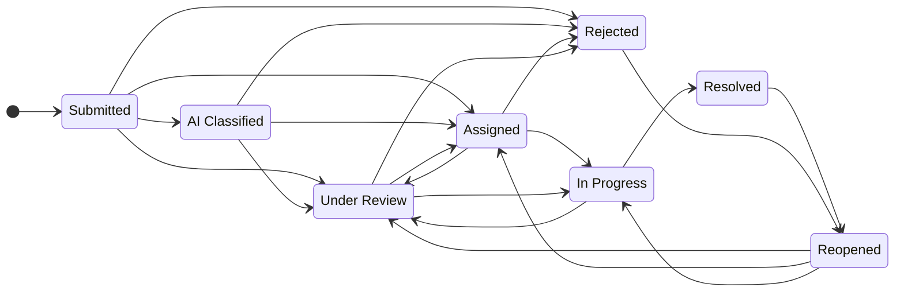
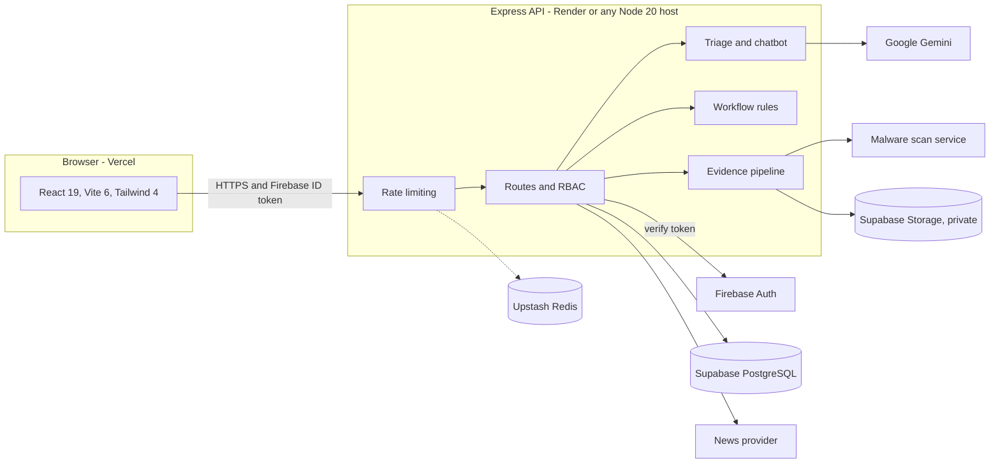

<div align="center">


<br>


**AI-assisted public grievance redressal for Tamil Nadu.**

Citizens file complaints in Tamil, English or Tanglish. The platform structures each complaint,
routes it to the right department, tracks it against a service-level target, and keeps
resolution evidence verifiable by the citizen who raised it.

[Features](#features) &nbsp;/&nbsp; [Architecture](#architecture) &nbsp;/&nbsp; [Quick start](#quick-start) &nbsp;/&nbsp;
[Configuration](#configuration) &nbsp;/&nbsp; [Deployment](#deployment) &nbsp;/&nbsp; [Security](#security) &nbsp;/&nbsp; [Testing](#testing)

</div>


## Why it exists

A civic complaint usually fails in the handoff: it is written in one language, filed under the wrong
department, and closed without the person who raised it ever seeing proof. Tamil-nadu-grievance-management treats the
whole lifecycle as one auditable flow.

1. **File** - by text or voice, in the language the citizen actually speaks.
2. **Triage** - AI structures the complaint and suggests a department, priority and SLA. Staff verify.
3. **Resolve** - an assigned officer works the case and attaches evidence.
4. **Verify** - the citizen confirms the fix or reopens the complaint.

Every state change is recorded in an append-only audit log.

## Features

| Citizens | Authorities | Platform integrity |
| --- | --- | --- |
| Complaint intake by text or voice in Tamil, English and Tanglish | AI triage: category, department, priority, confidence and a bilingual summary | Firebase-verified identity with role-based access: Citizen, Officer, Admin |
| Guided assistant that asks what happened, where, and what should be done, then hands off to the official form | Deterministic department routing, severity and SLA recommendation | Row Level Security on every table; service-role key stays on the server |
| Photo evidence (JPEG, PNG, WebP up to 400 KB) checked by file signature | Duplicate detection by token similarity | Controlled status transitions enforced server-side |
| Track any complaint by its ID (`GRV-2026-XXXXX`) | Officer queues scoped to assigned complaints | Append-only audit log enforced by a database trigger |
| Confirm a resolution or reopen it, with rating and comment | Escalation between departments with a recorded reason | Private evidence bucket served through an authenticated proxy |
| Live Tamil Nadu civic news and a directory of ministers with source links | Admin console to switch public site sections on and off | Fail-closed production validation and readiness probes |

### Priority and SLA

Recommendations are generated from the complaint text and are always advisory.

| Priority | SLA | Signals the rules look for |
| --- | --- | --- |
| Critical | 1 day | Live or exposed wire, electric shock, transformer spark, major pipe burst, life hazard |
| High | 3 days | Sewage overflow, dengue or mosquito breeding, flooding, blocked road |
| Medium | 7 days | Routine operational impact (default) |
| Low | 14 days | Submitted as low priority with no stronger signal |

Routing rules cover electrical, water and drainage, street lighting, roads, public health and
vector control, sanitation, and transport. Complaints fall into nine categories: Street Light,
Water Supply, Roads and Potholes, Sanitation and Drainage, Electricity and Power, Public Health and
Fogging, Transport and Traffic, Encroachment and Parks, and Other.

### Complaint lifecycle



Officers can only move a complaint to Under Review, In Progress or Resolved. Assigning, rejecting
and reopening are reserved for administrators and the verification flow.

## Architecture

The browser never talks to the database. All data access is mediated by the API.



### Tech stack

| Layer | Technology |
| --- | --- |
| Frontend | React 19, Vite 6, Tailwind CSS 4, lucide-react, canvas-confetti |
| API | Node.js 20, Express 4, bundled with esbuild to `dist/server.cjs` |
| Database and storage | Supabase PostgreSQL with Row Level Security, Supabase Storage |
| Identity | Firebase Authentication (ID tokens verified with the Admin SDK) |
| AI | Google Gemini through `@google/genai`, called from the server only |
| Rate limiting | Upstash Redis REST, with an in-memory fallback for local development |
| Language and tests | TypeScript 5.8, `node:test` with `tsx` |

### Project structure

```text
.
├── src/                       React client
│   ├── components/
│   ├── lib/firebase.ts        Firebase Auth only, no Firestore
│   ├── services/              API client, news, Wikimedia profile lookup
│   └── types.ts               Shared domain types
├── server.ts                  API entry point
├── server/
│   ├── grievanceIntelligence.ts   Routing, severity, SLA, duplicate scoring
│   ├── workflow.ts                Status transition rules
│   ├── storage.ts                 Evidence validation, scanning, private storage
│   ├── distributedRateLimit.ts    Redis-backed rate limiting
│   ├── observability.ts           Request metrics and alert webhook
│   └── supabase.ts                Server-only service-role client
├── supabase/migrations/       Schema, RLS policies, triggers, indexes
├── scripts/                   Server build, admin provisioning, production validation
├── evaluation/                Golden datasets for AI evaluation
├── tests/                     node:test suites
├── docs/                      Deployment, migration and evaluation notes
└── public/                    Logo, favicon, placeholders
```


## Quick start

**Prerequisites:** Node.js 20 or newer, a Supabase project, a Firebase project with Authentication
enabled, and a Gemini API key.

```bash
git clone https://github.com/leopears2008-cell/Tamil-nadu-grievance-management-.git
cd Tamil-nadu-grievance-management-
npm install
cp .env.example .env
```

1. Fill in `.env` (see [Configuration](#configuration)). Never put the Supabase service-role key in a `VITE_` variable.
2. Apply every file in `supabase/migrations/` to your Supabase database, in filename order, using the SQL editor or the Supabase CLI. The private evidence bucket is created automatically on first upload.
3. Start the development server:

   ```bash
   npm run dev
   ```

   The Vite dev server is configured for port `3000`.

4. Give yourself admin access. The account must already exist in Firebase Auth with a verified email:

   ```bash
   npm run provision-admin -- admin@example.com
   ```

   The script needs `FIREBASE_SERVICE_ACCOUNT_JSON`, `SUPABASE_URL` and `SUPABASE_SERVICE_ROLE_KEY` in the environment.

## Configuration

Copy `.env.example` to `.env`. Variables marked **Required** are enforced by `npm run validate:production`.

### API (server-only)

| Variable | Purpose | Production |
| --- | --- | --- |
| `GEMINI_API_KEY` | Server-side AI calls | Required |
| `SUPABASE_URL` | Supabase project URL | Required |
| `SUPABASE_SERVICE_ROLE_KEY` | Bypasses RLS, so server-only | Required |
| `FIREBASE_SERVICE_ACCOUNT_JSON` | Verifies Firebase ID tokens | Required |
| `ADMIN_EMAILS` | Comma-separated admin allowlist | Required |
| `CORS_ORIGINS` | Comma-separated frontend origins allowed to call the API | Required |
| `PUBLIC_API_URL` | Public base URL of the API, used for evidence links | Required |
| `UPSTASH_REDIS_REST_URL`, `UPSTASH_REDIS_REST_TOKEN` | Shared rate-limit store | Hardening gate |
| `CLAMAV_SCAN_URL` | Malware scanning service for uploads | Hardening gate |
| `GRIEVANCE_STORAGE_BUCKET` | Private evidence bucket name (`grievance-evidence`) | Hardening gate |
| `OBSERVABILITY_WEBHOOK_URL` | Receives alerts for HTTP 5xx responses | Hardening gate |
| `NEWS_PROVIDER`, `NEWS_API_KEY` | `newsapi` plus a key for the licensed news adapter | Hardening gate |

### Frontend (Vite)

| Variable | Purpose |
| --- | --- |
| `VITE_API_URL` | Public URL of the API |
| `VITE_FIREBASE_API_KEY`, `VITE_FIREBASE_AUTH_DOMAIN`, `VITE_FIREBASE_PROJECT_ID` | Firebase Auth client configuration |
| `VITE_FIREBASE_STORAGE_BUCKET`, `VITE_FIREBASE_MESSAGING_SENDER_ID`, `VITE_FIREBASE_APP_ID` | Firebase Auth client configuration |

### Scripts

| Command | What it does |
| --- | --- |
| `npm run dev` | Start the development server |
| `npm run build` | Build the client and the API bundle |
| `npm run build:client` / `build:server` | Build one half only (`dist/client`, `dist/server.cjs`) |
| `npm start` | Run the production API bundle |
| `npm run lint` | Type-check with `tsc --noEmit` |
| `npm test` | Run all `node:test` suites |
| `npm run test:e2e` | Run the workflow lifecycle suite |
| `npm run evaluate:ai` | Run the deterministic AI evaluation gate |
| `npm run validate:production` | Fail if required production variables or hardening controls are missing |
| `npm run provision-admin -- <email>` | Register a verified Firebase user as an admin |
| `npm run migrate:firestore-to-supabase` | One-way import of legacy Firestore data; it never modifies the source |

## Deployment

| Part | Target | Notes |
| --- | --- | --- |
| Frontend | Vercel | `vercel.json` builds with `npm run build:client`, serves `dist/client`, rewrites to the SPA entry, sets security headers and caches `/assets` as immutable |
| API | Render, or any Node 20 host | `render.yaml` defines `Tamil-nadu-grievance-management-api`: `npm install && npm run build:server`, started with `npm start`, health-checked at `/healthz` |

**Readiness:** `GET /healthz` reports liveness. `GET /readyz` checks dependencies and configuration and returns HTTP 503 when a required production dependency is not ready.

**Release sequence**

1. Apply the Supabase migrations.
2. Configure Upstash Redis, the malware scanner, the news provider and the alert webhook.
3. Set every production variable on the API host and the `VITE_` variables on Vercel.
4. Run `npm run validate:production`, then CI.
5. Deploy the API and confirm `/healthz` and `/readyz`.
6. Walk one complaint end to end: file, AI triage, assignment, resolution evidence, citizen verification.

## Security

- **Identity and roles.** Firebase ID tokens are verified on the server. Admins come from an allowlist plus an `admins` table. Officers are linked to verified Firebase accounts and only see complaints assigned to them.
- **Database.** Row Level Security is enabled on every table. A trigger restricts which complaint fields each role may change, and a second trigger makes the audit log append-only.
- **Evidence uploads.** Only JPEG, PNG and WebP up to 400 KB are accepted. The file signature must match the declared type, filenames are sanitised, a malware scan is required in production, and files live in a private bucket behind an authenticated proxy.
- **Workflow.** Status transitions are validated server-side, and officers have a narrower set than administrators.
- **Abuse protection.** Rate limiting with `X-RateLimit-*` headers, strict JSON size limits, request IDs and configurable proxy trust.
- **Browser hardening.** `X-Content-Type-Options`, `X-Frame-Options: DENY`, a strict `Referrer-Policy` and a minimal `Permissions-Policy`.
- **Secrets.** `.env*` files are git-ignored and `.env.example` holds placeholders only. The Firebase web configuration in the repository contains client identifiers, which are public by design.
- **Fail closed.** `validate:production` exits non-zero if a required variable or hardening control is missing.

To report a vulnerability, open a private security advisory on GitHub instead of a public issue.

## AI and responsible use

AI output is a recommendation, never a decision. Department, severity and SLA suggestions are labelled as
requiring staff verification, and they never change a complaint silently. The chatbot is instructed
not to invent government rules, departments or officers, and not to claim it has submitted a complaint.

`npm run evaluate:ai` runs a deterministic golden set that does not need Gemini credentials. It gates on:

- at least 100 classification cases, with department, priority and keyword coverage of 95% or higher
- retrieval precision, recall and F1 of 0.9 or higher on the RAG golden cases
- detection of every prompt-injection probe, and a guard that flags unsupported resolution claims

This is a regression baseline, not proof of production quality. See [`docs/AI_EVALUATION.md`](docs/AI_EVALUATION.md).

## Testing

```bash
npm run lint       # type-check
npm test           # unit, workflow, migration and wiring suites
npm run evaluate:ai
```

The suites cover routing and SLA rules, workflow transitions, evidence validation, news provider
sanitising and retries, Wikimedia profile matching, Supabase migration structure, and the production
hardening contract.

## Roadmap

- Replace the deterministic baseline with a reviewed Tamil, English and Tanglish golden set, including known duplicate pairs.
- Run live-model evaluation under an approved budget on non-production data.
- Move news to a licensed provider under a signed agreement.
- Seed reviewed production departments and officers in place of any demo identities.

## Contributing

Open an issue before large changes. Keep changes small, run `npm run lint` and `npm test`, and add a
test for any behaviour you change. Do not commit secrets or real citizen data.

## License

No license file is currently included in this repository.

## Acknowledgements

The landing page photograph of Fort St. George, Chennai is loaded from Wikimedia Commons and credited in the application.


<div align="center">

**Report. Route. Resolve.**

</div>
      
